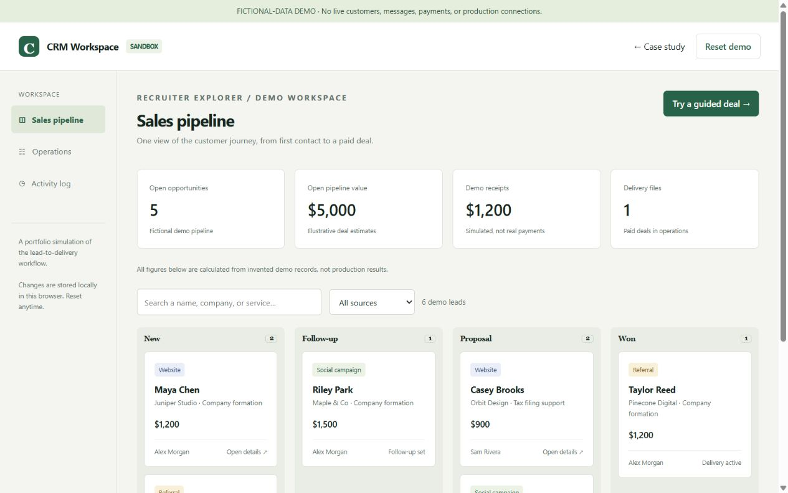

# CRM Portfolio

A recruiter-facing case study of **MyCG HQ CRM**, with a standalone interactive demonstration of the lead-to-delivery workflow.

**[Open the case study and demo](https://deepakpls007-web.github.io/crm-portfolio/)** · [Presenter's GitHub profile](https://github.com/deepakpls007-web)



## What to explore

1. Read the case study for the use case, system boundaries, and engineering decisions.
2. Open the demo and select **Try a guided deal**.
3. Set a follow-up date for the fictional lead, Maya Chen.
4. Prepare a demo quote, move to Proposal, simulate full payment, and mark the deal Won.
5. Open the delivery file and finish the ordered checklist.
6. Review the activity log. Reset the demo to start again.

## The business problem

A company-formation service has to connect enquiries, consultant follow-ups, quoting, payment, onboarding documents, filing, and delivery. The underlying application brings these functions into a shared, role-aware workspace.

The full source is held in a separate private repository. This public repository contains a newly written presentation and browser-only simulation. It does not contain the production CRM, client documents, staff records, live account instructions, database exports, or deployment credentials.

## Engineering discussion

- **Consistent intake:** normalize contact identifiers and match open enquiries across channels before assignment.
- **Stage guards:** require facts before status changes, such as a follow-up date or a quote.
- **Ledger reconciliation:** determine received money from payment rows rather than recording it twice at close.
- **Authorization boundaries:** the original code checks staff identities and permissions on the server, alongside database policies.
- **Operational handoff:** connect a won deal to onboarding and a delivery checklist, with an activity trail.

Read [the architecture](docs/architecture.md), [the case study](docs/case-study.md), and [the demo's security and privacy boundaries](SECURITY.md).

## Stack

| Full application, based on source review | Public showcase |
| --- | --- |
| Next.js 16, React 19, TypeScript, Tailwind 4 | Semantic HTML, CSS, vanilla JavaScript |
| Supabase Auth, Postgres, Storage | Fictional seed data and localStorage |
| Messaging, payment, email, and scheduling integrations | No external services or accounts |

## Run locally

With Node.js 20+ installed:

```sh
node scripts/serve.mjs
```

Open the URL printed in the terminal. There is no dependency installation, database, login, or environment file. `dist/` is the deployable website. GitHub Pages serves its contents from the `gh-pages` branch.

After changes are committed on `main`, update that deployment branch with:

```sh
git subtree push --prefix dist origin gh-pages
```

## Demo boundaries

All customer names, companies, amounts, and events in the demo are fictional. Changes stay in the browser's localStorage, with an in-memory fallback if storage is unavailable. Simulated payments do not charge anyone. Checklist completion does not submit filings. The role checks discussed in the case study describe the private application; the public demo does not implement or verify those controls.

This showcase is not evidence of production performance, test coverage, deployment readiness, or independently audited security. No customer counts, savings, revenue results, or adoption figures are asserted.

## Provenance and attribution

Presented by **Deepak** as a technical portfolio case study of the supplied MyCG HQ CRM handover project. The project documentation and selected implementation files informed the feature descriptions. The original handover was supplied separately from the public showcase.

This presentation does not claim sole authorship of the underlying application. Contribution scope and collaborative work should be discussed accurately during interviews. Original third-party notices and licenses belong with their respective components; no new license for the private application is granted by this showcase.

For a deeper review, request a guided walkthrough of selected private implementation details. Access to the complete source is not required to explore this demo.
