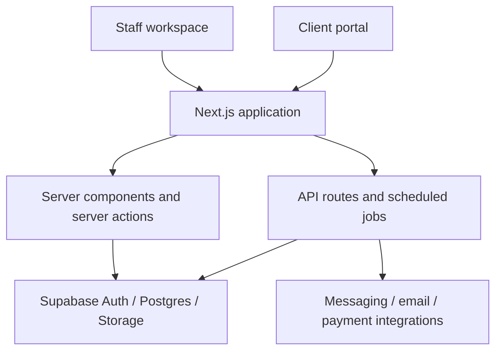
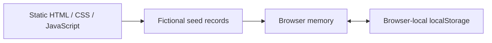

# Architecture and public demo boundaries

## Reviewed application

The application uses React 19, TypeScript, Tailwind CSS 4, and Next.js 16. The reviewed handover describes Supabase for authentication, row-level policies, database records, and document storage. External services are configured separately through environment settings.

## Public demo

The public demo has no server API, external script, font service, analytics, payment integration, customer uploads, authentication, or production database. It only requests its own static assets. Records can be reset locally. Demo inputs are escaped before HTML rendering.

The architecture case study describes the underlying application. It does not imply that server security, payment consistency, or production workflows are implemented by the static demo.
